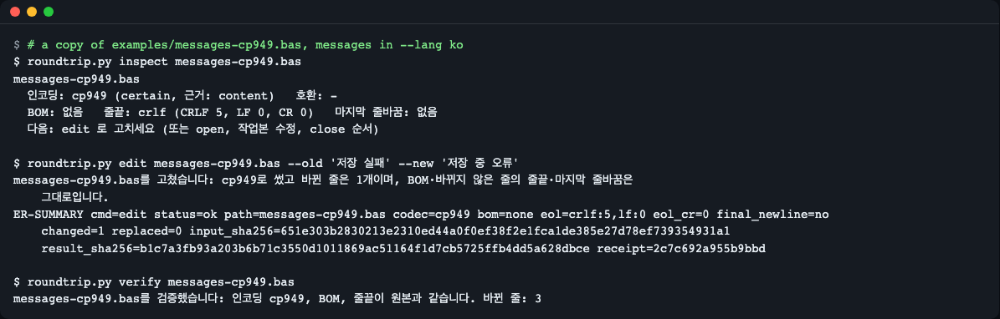
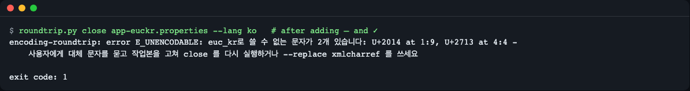
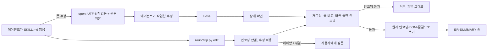

# encoding-roundtrip

[English](README.md) | **한국어**

코딩 에이전트가 UTF-8 이 아닌 파일(CP949, EUC-KR, Shift_JIS, GBK, Windows-125x, BOM 있는 UTF-8, CRLF·섞인 줄끝)을 고친 뒤에도 인코딩·BOM·줄마다의 줄끝·마지막 줄바꿈을 그대로 지켜, 고친 줄만 바뀐 상태로 돌려주게 하는 에이전트 스킬입니다. 함께 들어 있는 Python 스크립트(표준 라이브러리만)가 바이트 작업을 하고, 인코딩이 담을 수 없는 문자는 거부하며, 모든 명령의 마지막 줄에 확인할 수 있는 `ER-SUMMARY` 줄을 냅니다.


*`examples/messages-cp949.bas`(CP949, 줄끝 CRLF) 복사본에서 `inspect → edit → verify`. `edit` 한 번으로 `저장 실패` 를 `저장 중 오류` 로 바꾸고 그 `ER-SUMMARY` 줄을 보여 줍니다. `inspect`·`verify` 의 요약 줄은 그림에서 뺐습니다.*

## 무엇을 하나

- **한 번에 고치기.** `edit` 는 텍스트 찾아 바꾸기(`--old`/`--new`)나 줄 추가·끼워 넣기·바꾸기·지우기를 한 번의 호출로 하고, 원래 인코딩·BOM·줄마다의 줄끝·마지막 줄바꿈으로 되돌려 씁니다. 바꿀 수 없으면(표현할 수 없는 문자, 찾는 텍스트 없음, 인코딩 애매함) 아무것도 쓰지 않습니다.
- **손상 없는 왕복.** 큰 수정이면 `open` 은 파일을 UTF-8·LF 작업본으로 바꾸고 원본 바이트를 저장합니다. `close` 는 원래 인코딩·BOM·마지막 줄바꿈·줄마다의 줄끝을 되돌려 씁니다. 바뀌지 않은 줄은 원본 바이트 그대로 복사하므로, 한 줄 수정은 diff 에서도 한 줄입니다.
- **쓰기 전에 거부.** 대상 인코딩이 담을 수 없는 문자(Python `euc_kr` 코덱의 8바이트 채움 시퀀스 포함)는 `U+XXXX at 줄:열` 로 알려 주고 아무것도 쓰지 않습니다.
- **추측하지 않기.** `한글` 처럼 4바이트뿐인 파일은 여러 인코딩일 수 있습니다. 스크립트는 파일 말고도 프로젝트 힌트 두 가지를 읽기만 합니다(고치지 않음). 가장 가까운 `.gitattributes` 의 `working-tree-encoding` 항목, 그리고 내용만으로 동점일 때에 한해 같은 폴더의 다른 파일들이 가장 많이 쓰는 인코딩(이웃 파일 60개까지, `likely, 근거: folder` 로 표시)입니다. 그래도 정할 수 없으면 `E_AMBIGUOUS` 로 멈추고 `--encoding` 을 요구합니다. 줄마다 인코딩이 섞인 파일은 알려 주고(`E_MIXED_ENCODING`) 열지 않습니다.
- **쓰기 전마다 상태 확인.** `open` 없이 `close`, 두 번 `open`, 변조된 백업, UTF-8 이 아닌 작업본은 모두 종료 코드 3 으로 멈추고 대상 파일을 건드리지 않습니다.
- **그 밖의 명령.** `scan` 은 폴더 안 레거시 인코딩 파일을 나열하고, `verify` 는 결과를 원본과 비교하며, `status` 는 아직 열려 있는 파일을, `abort` 는 원본 바이트 복원을 합니다.
- 영어·한국어 메시지(`--lang en|ko`).

## 설치

**Claude Code**

```
/plugin marketplace add LeeGyeongPil/encoding-roundtrip
/plugin install encoding-roundtrip@encoding-roundtrip-skill
```

**Agent Skills 표준을 읽는 다른 에이전트** — `skills/encoding-roundtrip` 폴더를 에이전트의 스킬 폴더(예: 프로젝트의 `.agents/skills/`)에 복사합니다.

스크립트는 Python 3.10 이상만 있으면 되고 다른 것은 필요 없습니다. 네트워크도 쓰지 않습니다.

## 사용하기

평소 말투로 요청하면 에이전트가 스킬을 집어 듭니다. 영어 요청 예시입니다.

- "Edit `src/Form1.frm` (it is a Windows-1252 file) and change the caption to "Café Order". Keep the encoding as it is."
- "The editor refuses `legacy/report.cbl` with "file is not valid UTF-8". Can you still update the header comment in it?"
- "Add a `MAX_RETRY` constant to this Shift_JIS header `inc/const.h` without turning it into UTF-8."
- "After the last edit line 4 of `strings_ja.txt` looks garbled. Did that file end up with two encodings mixed together?"

한국어로 "CP949 인 `messages.bas` 의 문구만 고쳐 줘" 처럼 요청해도 됩니다.

저장소를 받아 직접 실행할 수도 있습니다. `examples/` 의 샘플은 실제 레거시 인코딩 파일입니다.

```
python3 skills/encoding-roundtrip/scripts/roundtrip.py inspect examples/messages-cp949.bas --lang ko
```

```
examples/messages-cp949.bas
  인코딩: cp949 (certain, 근거: content)   호환: -
  BOM: 없음   줄끝: crlf (CRLF 5, LF 0, CR 0)   마지막 줄바꿈: 없음
  다음: edit 로 고치세요 (또는 open, 작업본 수정, close 순서)
ER-SUMMARY cmd=inspect status=ok path=examples/messages-cp949.bas codec=cp949 confidence=certain bom=none eol=crlf:5,lf:0 eol_cr=0 final_newline=no mixed_encoding_lines=- plain=no input_sha256=651e303b2830213e2310ed44a0f0ef38f2e1fca1de385e27d78ef739354931a1 result_sha256=651e303b2830213e2310ed44a0f0ef38f2e1fca1de385e27d78ef739354931a1 receipt=98e1de04c70c268f
```

마지막 줄은 영어·한국어 화면이 같습니다. `receipt` 는 스크립트가 입력과 결과로 계산하는 짧은 해시라서, 스크립트가 낸 것이 아니라 손으로 적은 요약이면 알아볼 수 있습니다. 거부된 명령의 receipt 는 `status` 와 오류 `code` 까지 묶습니다.

`inspect` 는 진단 명령이라 늘 종료 코드 0 입니다. `edit`·`open` 이 거부할 파일(깨진 바이트, 10MB 초과, 지원하지 않는 인코딩)을 만나면 `이 파일은 쓸 수 없습니다: ...` 를 출력하고 요약 줄에 `usable=no problem=<코드>` 를 붙입니다. `<코드>` 는 그 명령들이 낼 오류 코드입니다.

```
broken.txt
  이 파일은 쓸 수 없습니다: 바이트가 올바른 utf-16-le 가 아닙니다
ER-SUMMARY cmd=inspect status=ok path=broken.txt codec=utf-16-le confidence=certain bom=utf-16le eol=crlf:0,lf:0 eol_cr=0 final_newline=no mixed_encoding_lines=- plain=no usable=no problem=E_DECODE_FAILED input_sha256=5f670429a5509d002a8174b5d73e9d3dd19d55ce6cdc0f1808f85f22b2fe3635 result_sha256=5f670429a5509d002a8174b5d73e9d3dd19d55ce6cdc0f1808f85f22b2fe3635 receipt=8cd3335d197474a9
```

(여기서 `broken.txt` 는 UTF-16 LE BOM 뒤에 UTF-16 이 아닌 바이트가 오는 파일입니다: `printf '\xff\xfe\xfa\x80abc\r\n' > broken.txt`.)

한 번에 고치기(파일 복사본에서 해 보세요). `inspect --text` 는 디코딩한 줄을 번호와 함께 보여 주고, `edit` 는 파일을 그 자리에서 고칩니다.

```
python3 skills/encoding-roundtrip/scripts/roundtrip.py inspect --text messages-cp949.bas --lang ko
python3 skills/encoding-roundtrip/scripts/roundtrip.py edit messages-cp949.bas --old '저장 실패' --new '저장 중 오류' --lang ko
```

```
3| Public Const MSG_SAVE_FAIL = "저장 실패"
...
messages-cp949.bas를 고쳤습니다: cp949로 썼고 바뀐 줄은 1개이며, BOM·바뀌지 않은 줄의 줄끝·마지막 줄바꿈은 그대로입니다.
ER-SUMMARY cmd=edit status=ok path=messages-cp949.bas codec=cp949 bom=none eol=crlf:5,lf:0 eol_cr=0 final_newline=no changed=1 replaced=0 input_sha256=651e303b2830213e2310ed44a0f0ef38f2e1fca1de385e27d78ef739354931a1 result_sha256=b1c7a3fb93a203b6b71c3550d1011869ac51164f1d7cb5725ffb4dd5a628dbce receipt=2c7c692a955b9bbd
```

한 번에 할 수 있는 다른 수정: `--append-line 텍스트`, `--insert-after N:텍스트`(0 = 첫 줄 앞), `--set-line N:텍스트`, `--delete-line N`, 모두 바꾸는 `--all`. 옵션은 여러 번 쓸 수 있습니다. `--all` 이 없으면 `--old` 는 정확히 한 번만 나와야 합니다(`E_NO_MATCH`, `E_MANY_MATCHES`).

큰 수정을 위한 순서(`open` 은 파일을 그 자리에서 UTF-8 작업본으로 바꿉니다).

```
python3 skills/encoding-roundtrip/scripts/roundtrip.py open messages-cp949.bas --lang ko
# UTF-8 을 다루는 아무 도구로 작업본을 고칩니다
python3 skills/encoding-roundtrip/scripts/roundtrip.py close messages-cp949.bas --lang ko
python3 skills/encoding-roundtrip/scripts/roundtrip.py verify messages-cp949.bas --lang ko
```

```
messages-cp949.bas를 닫았습니다: cp949로 되돌려 썼고 바뀐 줄은 1개이며, BOM·바뀌지 않은 줄의 줄끝·마지막 줄바꿈은 그대로입니다.
ER-SUMMARY cmd=close status=ok path=messages-cp949.bas codec=cp949 bom=none eol=crlf:5,lf:0 eol_cr=0 final_newline=no changed=1 replaced=0 input_sha256=651e303b2830213e2310ed44a0f0ef38f2e1fca1de385e27d78ef739354931a1 result_sha256=b1c7a3fb93a203b6b71c3550d1011869ac51164f1d7cb5725ffb4dd5a628dbce receipt=36f5572180eff83a
messages-cp949.bas를 검증했습니다: 인코딩 cp949, BOM, 줄끝이 원본과 같습니다. 바뀐 줄: 3
ER-SUMMARY cmd=verify status=ok path=messages-cp949.bas codec=cp949 changed=1 drift=0 input_sha256=651e303b2830213e2310ed44a0f0ef38f2e1fca1de385e27d78ef739354931a1 result_sha256=b1c7a3fb93a203b6b71c3550d1011869ac51164f1d7cb5725ffb4dd5a628dbce receipt=4f4384aaadea951e
```

새 글자를 파일의 인코딩으로 쓸 수 없으면 스크립트는 거부하고 파일은 그대로 둡니다. 아래는 EUC-KR 파일에 줄표 `—` 와 체크 표시 `✓` 를 넣은 경우입니다.


*`close` 는 종료 코드 1 로 끝나고 문자마다 줄과 열을 알려 줍니다. 아무것도 쓰지 않았고, 에이전트는 대체 문자를 묻거나 `--replace xmlcharref` 를 쓰라는 안내를 받습니다.*

인코딩이 섞인 파일은 열지 않습니다.

```
python3 skills/encoding-roundtrip/scripts/roundtrip.py open examples/strings-sjis-mixed.txt --lang ko   # exit 2
```

```
encoding-roundtrip: error E_MIXED_ENCODING: examples/strings-sjis-mixed.txt는 2 줄의 인코딩이 다릅니다 - 그 줄을 먼저 손으로 고치세요. 그대로 열면 그 줄이 깨집니다
ER-SUMMARY cmd=open status=error code=E_MIXED_ENCODING path=examples/strings-sjis-mixed.txt input_sha256=f1a5d9ce6b2ed81e8010537ff10f29fae0e5bd7e4a836456bedba92605a2cbec result_sha256=- receipt=4b90a95aff7df83a
```

작업을 시작하기 전에 `scan` 으로 저장소의 레거시 파일을 훑어볼 수 있습니다.

```
python3 skills/encoding-roundtrip/scripts/roundtrip.py scan examples --lang ko
```

```
파일 4개 검사: 레거시 인코딩 4, BOM 0, CRLF 4, 줄끝 혼합 0, 인코딩 혼합 1, 판별 보류 0, 건너뜀 0
가장 많은 레거시 인코딩: euc_kr
경로                             인코딩     확신     BOM   줄끝  끝 줄바꿈  표시
-------------------------------  ---------  -------  ----  ----  ---------  ---------
examples/app-euckr.properties    euc_kr     certain  없음  crlf  있음       -
examples/form-cp1252.frm         cp1252     likely   없음  crlf  있음       -
examples/messages-cp949.bas      cp949      certain  없음  crlf  없음       -
examples/strings-sjis-mixed.txt  shift_jis  certain  없음  crlf  있음       mixed-enc
```

화면 언어: `--lang en|ko`, 없으면 `ENCODING_ROUNDTRIP_LANG`, 그다음 `LC_ALL` / `LC_MESSAGES` / `LANG` 순이며 한국어가 아니면 영어입니다. 오류 코드와 `ER-SUMMARY` 줄은 언어에 따라 바뀌지 않습니다.

## 명령과 종료 코드

모든 명령은 `--lang en|ko`, `--state-dir DIR`, `--json` 을 받습니다. 나머지 옵션은 `roundtrip.py <명령> --help` 로 봅니다.

| 명령 | 하는 일 | 파일을 쓰나 |
|---|---|---|
| `inspect FILE...` | 인코딩·확신도·BOM·줄끝·마지막 줄바꿈·인코딩이 섞인 줄. `--text` 는 디코딩한 줄을 번호와 함께 보여 줍니다. | 아니요(대상 파일은 바꾸지 않지만 `report.json` 이 든 `.encoding-roundtrip/` 상태 폴더는 만듭니다) |
| `scan FOLDER` | 폴더 안에서 순수 UTF-8·LF 가 아닌 파일을 표로 보여 줍니다(`--max-files`, 기본 2000). | 아니요 |
| `edit FILE ...` | 한 번의 수정(`--old`/`--new`, `--append-line`, `--insert-after`, `--set-line`, `--delete-line`)을 원래 형식으로 되돌려 씁니다. | 예, 수정 전체를 쓸 수 있을 때만 |
| `open FILE` | 원본 바이트를 저장하고 파일을 UTF-8·LF 작업본으로 바꿉니다. | 예(작업본) |
| `close FILE` | 작업본을 원래 인코딩·BOM·줄끝·마지막 줄바꿈으로 되돌려 씁니다. | 예, 모든 문자를 쓸 수 있을 때만 |
| `abort FILE` | 원본 바이트를 되돌리고 세션을 끝냅니다. | 예(원본 바이트) |
| `verify FILE` | 지금 파일을 원본과 비교합니다: 인코딩·BOM·줄끝·마지막 줄바꿈·바뀐 줄. | 아니요 |
| `status` | 열려 있는(아직 close·abort 하지 않은) 파일을 나열합니다. | 아니요 |

| 종료 코드 | 뜻 | 오류 코드 |
|---|---|---|
| 0 | 끝남(`inspect` 는 파일을 쓸 수 없을 때도 0, `usable=no` 참고) | - |
| 1 | 수정이 거부됨, 아무것도 쓰지 않음 | `E_UNENCODABLE`, `E_NO_MATCH`, `E_MANY_MATCHES`, `E_DRIFT`(`verify` 가 차이를 찾음) |
| 2 | 파일이나 요청을 처리할 수 없음 | `E_NOT_FOUND`, `E_BINARY`, `E_AMBIGUOUS`, `E_UNKNOWN_CODEC`, `E_UNSUPPORTED`, `E_DECODE_FAILED`, `E_MIXED_ENCODING`, `E_BAD_EDIT`, `E_IO`, 잘못된 명령줄 인자 |
| 3 | 세션 상태상 이 단계를 할 수 없음, 대상 파일은 건드리지 않음 | `E_NOT_OPEN`, `E_ALREADY_OPEN`, `E_STATE_MISMATCH`(변조된 백업, UTF-8 이 아닌 작업본) |

오류 줄은 모두 `encoding-roundtrip: error E_코드: <무슨 일인지> - <어떻게 할지>` 꼴이고, 그 뒤에 `status=error code=E_코드` 가 든 `ER-SUMMARY` 줄이 옵니다.

## 검증된 동작

<!-- skill-eval:start -->
실측 스킬 평가, 2026-11-13, 버전 0.1.2, Claude Code 2.1.322 + `sonnet` 모델, 케이스마다 3회 실행:

| 항목 | 결과 |
|---|---|
| 스킬을 불러와야 하는 요청 | 12 / 12 불러옴 |
| 불러오면 안 되는 근접 요청 | 1 / 11 이 그래도 불러옴(0.091) |
| 스킬을 쓴 작업 케이스 통과 | 6 / 6 (모든 케이스 1.0점) |
| 스킬 없이 작업 케이스 통과 | 0 / 6 |
| 스킬로 오른 평균 점수 | +0.639 |
| 일부러 망가뜨린 스크립트를 작업 채점기가 잡아낸 비율 | 6 / 6 (1.0) |
| 같은 작업 케이스를 Codex CLI 0.154.0 으로 | 6 / 6 |
<!-- skill-eval:end -->

2026-11-13 에 로컬에서 측정한 값입니다.

- `uv run pytest -q --cov=skills/encoding-roundtrip/scripts --cov-fail-under=85`: 156개 통과, 스크립트 줄 커버리지 94%. `uv run --python 3.10 --isolated pytest -q` 도 156개 통과.
- 평가용 픽스처마다 `edit` 와 `open` → 수정 → `close` 가 같은 바이트를 만든다는 것을 테스트로 확인합니다.
- 3.70MB·6만 줄 CP949 파일: `open` 0.37초, 한 줄 수정 뒤 `close` 0.26초, 같은 수정을 `edit` 한 번으로 0.53초. 두 결과 모두 기대 파일과 바이트까지 같음.
- 판별: 확장 음절 `똠` 이 든 순수 CP949 는 certain, KS X 1001 안에 드는 한국어는 `euc_kr`(호환 `cp949`), 일본어는 `shift_jis`(호환 `cp932`), 체코어 `cp1250`·독일어 `cp1252` 는 `likely`, 러시아어 `cp1251` 은 certain. 아주 짧은 파일(`한글`, `펲`, `中文`)은 일부러 `ambiguous` 로 두며, 짧은 프랑스어 문장도 그럴 수 있습니다.

## 동작 원리



- 에이전트는 `SKILL.md` 를 읽고 파일을 `edit` 한 번으로 고치며, 자기 편집 도구·`iconv`·`unix2dos`·`dos2unix` 로는 고치지 않고, 요약 줄을 받으면 멈춥니다.
- `edit` 는 파일을 디코딩해 메모리에서 수정한 뒤 `close` 와 같은 재구성 과정을 거치므로, 수정 전체를 쓸 수 있을 때만 디스크가 바뀝니다.
- `open` 은 원본 바이트와 세션 기록을 상태 폴더(`<git 루트>/.encoding-roundtrip`, 없으면 파일이 있는 폴더)에 저장하고, 같은 경로에 UTF-8·LF 작업본을 둡니다.
- `close` 는 `difflib` 로 원본 줄과 고친 줄을 짝짓고, 같은 줄은 원본 바이트를 유지하고, 바뀐 줄만 인코딩하며, 같은 폴더의 임시 파일로 교체한 뒤 다시 읽어 확인합니다.
- 스크립트가 쓰는 것은 지정한 파일과 상태 폴더뿐입니다. 인코딩을 정하려고 가장 가까운 `.gitattributes`·`.editorconfig` 와, 내용만으로 동점일 때 같은 폴더의 다른 파일도 읽지만 고치지는 않습니다. 네트워크도 추가 권한도 없습니다.

## 언제 쓰나

- 잘 맞는 경우: 에이전트가 CP949·Shift_JIS·GBK·Windows-125x(또는 BOM·CRLF) 소스·설정 파일을 고쳐야 하고 diff 는 작게, 인코딩은 그대로여야 할 때.
- 맞지 않는 경우: 저장소를 영구히 UTF-8 로 바꾸거나 줄끝을 통일하는 일. 그럴 때는 `iconv`, `.gitattributes` 의 `working-tree-encoding`, 편집기의 인코딩 변환을 쓰세요.
- 그냥 UTF-8·LF 인 파일은 스킬 없이 에이전트의 기본 도구로 충분합니다.

## 한계

- **섞인 인코딩은 진단만 하고 고치지 않습니다.** `inspect` 가 다른 인코딩인 줄을 알려 주고 `open`·`edit` 는 `E_MIXED_ENCODING` 으로 거부합니다. 그 줄을 고치는 것은 사용자 몫입니다.
- **지원하지 않는 것:** ISO-2022-JP 같은 상태 있는 인코딩, UTF-32, BOM 없는 UTF-16(NUL 바이트가 있어 바이너리로 봅니다). `inspect` 는 이런 파일에 `usable=no problem=E_UNSUPPORTED` 또는 `E_BINARY` 를 붙입니다.
- **10MB 가 넘는 파일은 거부합니다**(`E_UNSUPPORTED`).
- **짧은 파일은 `--encoding` 이 필요합니다.** 비 ASCII 문자가 몇 개뿐이면 여러 코덱이 똑같이 들어맞습니다. `.gitattributes` 항목이나 이웃 파일로 정해지지 않으면 `E_AMBIGUOUS` 로 멈춥니다. Windows-1252 로 쓴 짧은 프랑스어·독일어 문장도 애매할 수 있습니다.
- **판별은 점수 규칙이지 확실성이 아닙니다.** `likely` 는 한 코덱 계열에서 점수가 높았다는 뜻입니다. `cp1250`·`cp1251`·`cp1252` 는 거의 모든 바이트를 받아들이므로 서유럽·중유럽 파일의 `likely` 결과는 확인해 보세요.
- **`inspect --text` 는 파일당 2000줄까지만** 보여 줍니다.
- **`-` 로 시작하는 값**은 `--old='-text'` 처럼 `=` 로 붙여 써야 합니다. 아니면 명령줄 해석기가 옵션으로 읽습니다.
- **명령줄 사용법 오류 문장은 `--lang ko` 에서도 영어**입니다(예: `expected one argument`). 도움말과 스크립트 자체 메시지는 모두 번역돼 있습니다.
- **스킬은 에이전트가 `SKILL.md` 를 따르는 것에 기댑니다.** 에이전트가 자기 도구로 파일을 써 버리면 스크립트가 막을 수 없고, `ER-SUMMARY` 줄과 `verify` 로 나중에 확인할 수 있을 뿐입니다.

## 대안

2026-11-13 에 확인했습니다. 저마다 같은 문제의 일부를 다른 방식으로 풉니다.

| 프로젝트 | 무엇인가 | 이 스킬과 다른 점 |
|---|---|---|
| [claude_encoding_guard](https://github.com/ymonster/claude_encoding_guard) | Claude Code 훅 플러그인, MIT | Claude Code 자체 편집 도구 앞뒤에서 도는 훅이라 Claude Code 에서만 동작합니다. 판별에 chardet 을 씁니다. |
| [mcp-file-tools](https://github.com/dimitar-grigorov/mcp-file-tools) | Go 로 만든 MCP 서버, GPL-3.0 | 에이전트가 평소 편집 흐름 대신 서버의 MCP 도구로 비 UTF-8 파일을 읽고 씁니다. 서버 바이너리가 필요합니다. 인코딩 목록에 CP949(UHC)는 없습니다. |
| [chardet](https://github.com/chardet/chardet) 7.7.0, [charset-normalizer](https://github.com/jawah/charset_normalizer) 3.5.2 | Python 인코딩 판별 라이브러리 | 판별만 하고 왕복 변환은 하지 않습니다. 우리 프로브에서 둘 다 2~4바이트 샘플 일부를 잘못 판별했습니다(chardet: `펲` → Windows-1252, charset-normalizer: `한글`·`中文` → big5). 그래서 이 스크립트는 짧은 파일을 추측하지 않고 거부합니다. |
| [git `working-tree-encoding`](https://git-scm.com/docs/gitattributes) | git 속성 | 저장소와 작업 트리 사이를 변환합니다. 에이전트가 파일을 다시 쓰는 순간은 막지 못하고, libgit2·JGit 은 지원하지 않습니다. 이 스크립트는 힌트로 읽습니다. |
| `iconv` | 명령줄 변환기 | 파일 전체를 변환합니다. 영구히 UTF-8 로 바꿀 때 쓰세요. |

## 개발

```
uv sync && uv run pytest -q
```

`evals/` 는 `claude plugin eval` 용 평가 세트입니다. 발동 12개, 미발동 11개(근접 6개), 작업 6개(오류 케이스 2개)이고 픽스처는 `evals/fixtures/` 에 있습니다. `tools/make_fixtures.py`, `tools/make_evals.py` 가 다시 만들어 줍니다(`--check` 로 검증).

변경 내역은 [CHANGELOG.md](CHANGELOG.md) 에 있습니다.

## 라이선스

MIT. [LICENSE](LICENSE) 를 보세요.
