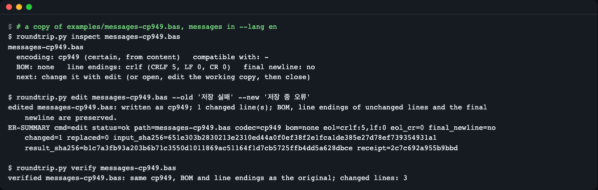
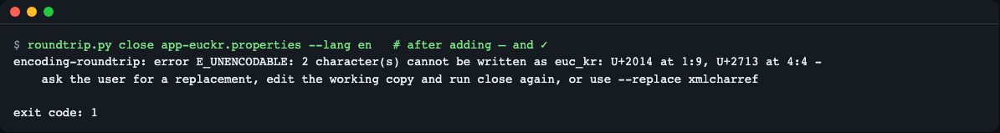
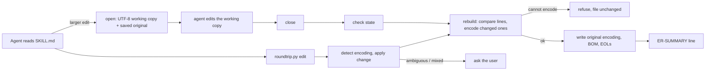

# encoding-roundtrip

**English** | [한국어](README.ko.md)

An agent skill that lets a coding agent edit files that are not plain UTF-8 with LF (CP949, EUC-KR, Shift_JIS, GBK, Windows-125x, UTF-8 with BOM, CRLF or mixed line endings) and hand them back byte-exact: same encoding, BOM, per-line line endings and final newline, with only the lines you edited changed. A bundled Python script (standard library only) does the byte work, refuses characters the encoding cannot hold, and ends every command with a checkable `ER-SUMMARY` line.


*`inspect → edit → verify` on a copy of `examples/messages-cp949.bas` (CP949, CRLF endings). One `edit` call changes `저장 실패` to `저장 중 오류` and prints its `ER-SUMMARY` line; the summary lines of `inspect` and `verify` are left out of the picture.*

## What it does

- **One-call edits.** `edit` finds and replaces text (`--old`/`--new`) or appends, inserts, sets or deletes lines, and writes the file back in its original encoding, BOM, per-line line endings and final newline. If the change does not fit (unencodable character, text not found, ambiguous encoding), nothing is written.
- **Round trip without damage.** For larger edits, `open` turns the file into a UTF-8 working copy with LF endings and saves the original bytes. `close` writes the original encoding, BOM, final newline and per-line line endings back. Unchanged lines are copied as the original bytes, so a one-line edit stays a one-line diff.
- **Refuses before writing.** Characters the target encoding cannot hold (including the 8-byte filler sequences of Python's `euc_kr` codec) are reported as `U+XXXX at line:column` and nothing is written.
- **Does not guess.** A four-byte file such as `한글` could be several encodings. Besides the file itself, the script reads (never writes) two project hints: a `working-tree-encoding` entry in the nearest `.gitattributes`, and, only when the content is a tie, the encoding most other files in the same folder use (up to 60 neighbours, reported as `likely, from folder`). If there is still no answer it says `E_AMBIGUOUS` and asks for `--encoding`. A file that mixes encodings line by line is reported (`E_MIXED_ENCODING`) and not opened.
- **Checks state before every write.** `close` without `open`, a double `open`, a tampered backup or a working copy that is not UTF-8 all stop with exit code 3 and leave the target file untouched.
- **Other commands.** `scan` lists legacy-encoded files in a folder, `verify` compares the result with the original, `status` lists files still open, `abort` restores the original bytes.
- English and Korean messages (`--lang en|ko`).

## Install

**Claude Code**

```
/plugin marketplace add LeeGyeongPil/encoding-roundtrip
/plugin install encoding-roundtrip@encoding-roundtrip-skill
```

**Other agents that read the Agent Skills standard** — copy `skills/encoding-roundtrip` into the agent's skills folder (for example `.agents/skills/` in a project).

The script needs Python 3.10 or newer and nothing else. It does not use the network.

## Use it

Ask in plain words. These requests make the agent pick the skill up:

- "Edit `src/Form1.frm` (it is a Windows-1252 file) and change the caption to "Café Order". Keep the encoding as it is."
- "The editor refuses `legacy/report.cbl` with "file is not valid UTF-8". Can you still update the header comment in it?"
- "Add a `MAX_RETRY` constant to this Shift_JIS header `inc/const.h` without turning it into UTF-8."
- "After the last edit line 4 of `strings_ja.txt` looks garbled. Did that file end up with two encodings mixed together?"

You can also run the script yourself, from a checkout of this repository. The sample files in `examples/` are real legacy-encoded files.

```
python3 skills/encoding-roundtrip/scripts/roundtrip.py inspect examples/messages-cp949.bas
```

```
examples/messages-cp949.bas
  encoding: cp949 (certain, from content)   compatible with: -
  BOM: none   line endings: crlf (CRLF 5, LF 0, CR 0)   final newline: no
  next: change it with edit (or open, edit the working copy, then close)
ER-SUMMARY cmd=inspect status=ok path=examples/messages-cp949.bas codec=cp949 confidence=certain bom=none eol=crlf:5,lf:0 eol_cr=0 final_newline=no mixed_encoding_lines=- plain=no input_sha256=651e303b2830213e2310ed44a0f0ef38f2e1fca1de385e27d78ef739354931a1 result_sha256=651e303b2830213e2310ed44a0f0ef38f2e1fca1de385e27d78ef739354931a1 receipt=98e1de04c70c268f
```

The last line is the same in English and Korean. `receipt` is a short hash the script computes from the input and the result, so a summary that was typed by hand instead of produced by the script can be spotted. For a refused command the receipt also covers `status` and the error `code`.

`inspect` is a diagnosis command and always exits 0. When it finds a file that `edit` and `open` would refuse (invalid bytes, larger than 10 MB, an unsupported encoding), it says `cannot use this file: ...` and adds `usable=no problem=<code>` to the summary line, where `<code>` is the error those commands would give:

```
broken.txt
  cannot use this file: bytes are not valid utf-16-le
ER-SUMMARY cmd=inspect status=ok path=broken.txt codec=utf-16-le confidence=certain bom=utf-16le eol=crlf:0,lf:0 eol_cr=0 final_newline=no mixed_encoding_lines=- plain=no usable=no problem=E_DECODE_FAILED input_sha256=5f670429a5509d002a8174b5d73e9d3dd19d55ce6cdc0f1808f85f22b2fe3635 result_sha256=5f670429a5509d002a8174b5d73e9d3dd19d55ce6cdc0f1808f85f22b2fe3635 receipt=8cd3335d197474a9
```

(`broken.txt` here is a UTF-16 LE BOM followed by bytes that are not UTF-16: `printf '\xff\xfe\xfa\x80abc\r\n' > broken.txt`.)

One-call edit (work on a copy of the file). `inspect --text` shows the decoded lines with numbers; `edit` changes the file in place:

```
python3 skills/encoding-roundtrip/scripts/roundtrip.py inspect --text messages-cp949.bas
python3 skills/encoding-roundtrip/scripts/roundtrip.py edit messages-cp949.bas --old '저장 실패' --new '저장 중 오류'
```

```
3| Public Const MSG_SAVE_FAIL = "저장 실패"
...
edited messages-cp949.bas: written as cp949; 1 changed line(s); BOM, line endings of unchanged lines and the final newline are preserved.
ER-SUMMARY cmd=edit status=ok path=messages-cp949.bas codec=cp949 bom=none eol=crlf:5,lf:0 eol_cr=0 final_newline=no changed=1 replaced=0 input_sha256=651e303b2830213e2310ed44a0f0ef38f2e1fca1de385e27d78ef739354931a1 result_sha256=b1c7a3fb93a203b6b71c3550d1011869ac51164f1d7cb5725ffb4dd5a628dbce receipt=2c7c692a955b9bbd
```

Other changes in one call: `--append-line TEXT`, `--insert-after N:TEXT` (0 = before line 1), `--set-line N:TEXT`, `--delete-line N`, and `--all` to replace every match. Options may repeat. `--old` must match exactly once unless `--all` is given (`E_NO_MATCH`, `E_MANY_MATCHES`).

Edit cycle for larger changes (`open` replaces the file in place with a UTF-8 working copy):

```
python3 skills/encoding-roundtrip/scripts/roundtrip.py open messages-cp949.bas
# edit the working copy with any UTF-8 tool
python3 skills/encoding-roundtrip/scripts/roundtrip.py close messages-cp949.bas
python3 skills/encoding-roundtrip/scripts/roundtrip.py verify messages-cp949.bas
```

```
closed messages-cp949.bas: written back as cp949; 1 changed line(s); BOM, line endings of unchanged lines and the final newline are preserved.
ER-SUMMARY cmd=close status=ok path=messages-cp949.bas codec=cp949 bom=none eol=crlf:5,lf:0 eol_cr=0 final_newline=no changed=1 replaced=0 input_sha256=651e303b2830213e2310ed44a0f0ef38f2e1fca1de385e27d78ef739354931a1 result_sha256=b1c7a3fb93a203b6b71c3550d1011869ac51164f1d7cb5725ffb4dd5a628dbce receipt=36f5572180eff83a
verified messages-cp949.bas: same cp949, BOM and line endings as the original; changed lines: 3
ER-SUMMARY cmd=verify status=ok path=messages-cp949.bas codec=cp949 changed=1 drift=0 input_sha256=651e303b2830213e2310ed44a0f0ef38f2e1fca1de385e27d78ef739354931a1 result_sha256=b1c7a3fb93a203b6b71c3550d1011869ac51164f1d7cb5725ffb4dd5a628dbce receipt=4f4384aaadea951e
```

When the new text cannot be written in the file's encoding, the script refuses and the file stays as it was. Here a dash `—` and a check mark `✓` were added to an EUC-KR file:


*`close` exits with code 1 and names each character with its line and column. Nothing was written; the agent is told to ask for a replacement or to use `--replace xmlcharref`.*

A file that mixes encodings is not opened:

```
python3 skills/encoding-roundtrip/scripts/roundtrip.py open examples/strings-sjis-mixed.txt   # exit 2
```

```
encoding-roundtrip: error E_MIXED_ENCODING: examples/strings-sjis-mixed.txt mixes encodings on lines 2 - fix those lines by hand first; opening would corrupt them
ER-SUMMARY cmd=open status=error code=E_MIXED_ENCODING path=examples/strings-sjis-mixed.txt input_sha256=f1a5d9ce6b2ed81e8010537ff10f29fae0e5bd7e4a836456bedba92605a2cbec result_sha256=- receipt=4b90a95aff7df83a
```

`scan` shows the legacy files in a repository before you start:

```
python3 skills/encoding-roundtrip/scripts/roundtrip.py scan examples
```

```
scanned 4 file(s): 4 legacy-encoded, 0 with BOM, 4 CRLF, 0 mixed line endings, 1 mixed encodings, 0 undecided, 0 skipped
most common legacy encoding: euc_kr
path                             encoding   confidence  BOM   line endings  final NL  flags
-------------------------------  ---------  ----------  ----  ------------  --------  ---------
examples/app-euckr.properties    euc_kr     certain     none  crlf          yes       -
examples/form-cp1252.frm         cp1252     likely      none  crlf          yes       -
examples/messages-cp949.bas      cp949      certain     none  crlf          no        -
examples/strings-sjis-mixed.txt  shift_jis  certain     none  crlf          yes       mixed-enc
```

Language: `--lang en|ko`, else `ENCODING_ROUNDTRIP_LANG`, else `LC_ALL` / `LC_MESSAGES` / `LANG`; anything that is not Korean falls back to English. Error codes and the `ER-SUMMARY` line do not change with the language.

## Commands and exit codes

All commands take `--lang en|ko`, `--state-dir DIR` and `--json`. `roundtrip.py <command> --help` lists the rest.

| Command | What it does | Writes the file? |
|---|---|---|
| `inspect FILE...` | Encoding, confidence, BOM, line endings, final newline, mixed-encoding lines. `--text` adds the decoded lines with numbers. | No (the target file is never changed, but a `.encoding-roundtrip/` state folder with `report.json` is created) |
| `scan FOLDER` | Table of the files in a folder that are not plain UTF-8 with LF (`--max-files`, default 2000). | No |
| `edit FILE ...` | One change (`--old`/`--new`, `--append-line`, `--insert-after`, `--set-line`, `--delete-line`), written back in the original form. | Yes, only if the whole change fits |
| `open FILE` | Saves the original bytes and turns the file into a UTF-8, LF working copy. | Yes (working copy) |
| `close FILE` | Writes the working copy back in the original encoding, BOM, line endings and final newline. | Yes, only if every character fits |
| `abort FILE` | Puts the original bytes back and ends the session. | Yes (original bytes) |
| `verify FILE` | Compares the current file with the original: encoding, BOM, line endings, final newline, changed lines. | No |
| `status` | Lists files that are open (not closed or aborted yet). | No |

| Exit code | Meaning | Error codes |
|---|---|---|
| 0 | Done (for `inspect`, also when the file is not usable; see `usable=no`) | - |
| 1 | The change was refused; nothing was written | `E_UNENCODABLE`, `E_NO_MATCH`, `E_MANY_MATCHES`, `E_DRIFT` (`verify` found a difference) |
| 2 | The file or the request cannot be handled | `E_NOT_FOUND`, `E_BINARY`, `E_AMBIGUOUS`, `E_UNKNOWN_CODEC`, `E_UNSUPPORTED`, `E_DECODE_FAILED`, `E_MIXED_ENCODING`, `E_BAD_EDIT`, `E_IO`, and wrong command-line arguments |
| 3 | The session state does not allow this step; the target file was not touched | `E_NOT_OPEN`, `E_ALREADY_OPEN`, `E_STATE_MISMATCH` (tampered backup, working copy not UTF-8) |

Every error line has the form `encoding-roundtrip: error E_CODE: <what happened> - <what to do>`, followed by an `ER-SUMMARY` line with `status=error code=E_CODE`.

## Verified behavior

<!-- skill-eval:start -->
| Check | Result |
|---|---|
| Triggers when it should | 12/12 |
| Stays quiet when it should not | 10/11 |
| Tasks solved with the skill | 6/6 |
| Tasks solved without it (baseline) | 0/6 |
| Mean score gain (Δ) | +0.64 |
| Tasks that catch a broken script | 6/6 |
| Codex CLI | 6/6 tasks · verified |

Measured 2026-11-13 with Claude Code 2.1.322 · sonnet · 3 runs per case · codex-cli 0.154.0
<!-- skill-eval:end -->

Measured locally on 2026-11-13:

- `uv run pytest -q --cov=skills/encoding-roundtrip/scripts --cov-fail-under=85`: 156 passed, 94% line coverage of the script; `uv run --python 3.10 --isolated pytest -q` also gives 156 passed.
- For every evaluation fixture, `edit` and `open` -> edit -> `close` produce the same bytes (checked by the tests).
- A 3.70 MB CP949 file with 60,000 lines: `open` 0.37 s and `close` after a one-line edit 0.26 s; the same change with one `edit` call 0.53 s. Both results are byte-identical to the expected file.
- Detection: pure CP949 (with the extended syllable `똠`) is certain; Korean text that fits KS X 1001 is `euc_kr` with `cp949` listed as compatible; Japanese is `shift_jis` (compatible `cp932`); Czech `cp1250` and German `cp1252` are `likely`; Russian `cp1251` is certain. Very short files (`한글`, `펲`, `中文`) are `ambiguous` on purpose, and a short French sentence may be too.

## How it works



- The agent reads `SKILL.md`, which tells it to change a file with one `edit` call, never with its own edit tools, `iconv`, `unix2dos` or `dos2unix`, and to stop after the summary line.
- `edit` decodes the file, applies the change in memory and runs the same rebuild as `close`, so nothing on disk changes unless the whole change can be written.
- `open` saves the original bytes and a session record under a state folder (`<git root>/.encoding-roundtrip`, or the file's folder), and leaves a UTF-8, LF working copy at the same path.
- `close` pairs original and edited lines with `difflib`, keeps the original bytes of equal lines, encodes only changed lines, and replaces the file through a temporary file in the same folder, then reads it back to check.
- The script writes only the files you name and its state folder. To decide an encoding it also reads the nearest `.gitattributes` and `.editorconfig` and, when the content is a tie, other files in the same folder; it never changes them. No network, no extra permissions.

## When to use it

- Good fit: an agent has to change a source or config file in CP949, Shift_JIS, GBK or Windows-125x (or a BOM/CRLF file) and the diff must stay small and the encoding unchanged.
- Not the tool for: converting a repository to UTF-8 for good, or normalizing line endings. Use `iconv`, `git` attributes such as `working-tree-encoding`, or your editor's re-encode feature for that.
- Files that are plain UTF-8 with LF need no skill; the agent's normal tools are enough.

## Limitations

- **Mixed encodings are diagnosed, not repaired.** `inspect` names the lines that use another encoding and `open`/`edit` refuse the file with `E_MIXED_ENCODING`. Fixing those lines is up to you.
- **Not supported:** ISO-2022-JP and other stateful encodings, UTF-32, and UTF-16 without a BOM (it contains NUL bytes and is treated as binary). `inspect` reports these as `usable=no problem=E_UNSUPPORTED` or `E_BINARY`.
- **Files over 10 MB are refused** (`E_UNSUPPORTED`).
- **Short files need `--encoding`.** With only a few non-ASCII characters several codecs fit equally well. Unless a `.gitattributes` entry or the neighbouring files decide it, the script stops with `E_AMBIGUOUS`. A short French or German sentence in Windows-1252 can be ambiguous too.
- **Detection is a scoring rule, not certainty.** `likely` means the text scored well in one codec family; `cp1250`, `cp1251` and `cp1252` accept almost any byte, so check `likely` results for Western and Central European files.
- **`inspect --text` prints at most 2000 lines** per file.
- **Values that start with `-`** must be written with `=`, for example `--old='-text'`, or the command line parser reads them as an option.
- **Command-line usage errors stay in English** under `--lang ko` (for example `expected one argument`); the help text and all of the script's own messages are translated.
- **The skill relies on the agent following `SKILL.md`.** The script cannot stop an agent that writes the file with its own tools; the `ER-SUMMARY` line and `verify` let you check afterwards.

## Alternatives

Checked on 2026-11-13. Each solves a part of the same problem in a different way.

| Project | What it is | How it differs from this skill |
|---|---|---|
| [claude_encoding_guard](https://github.com/ymonster/claude_encoding_guard) | Claude Code hook plugin, MIT | Runs as a hook around Claude Code's own edit tools, so it works only in Claude Code. Uses chardet for detection. |
| [mcp-file-tools](https://github.com/dimitar-grigorov/mcp-file-tools) | MCP server written in Go, GPL-3.0 | The agent reads and writes non-UTF-8 files through the server's own MCP tools instead of its normal edit flow; needs the server binary. CP949 (UHC) is not in its list of encodings. |
| [chardet](https://github.com/chardet/chardet) 7.7.0, [charset-normalizer](https://github.com/jawah/charset_normalizer) 3.5.2 | Python encoding detection libraries | Detection only, no round trip. In our probe both misjudged some 2-4 byte samples (chardet: `펲` as Windows-1252; charset-normalizer: `한글` and `中文` as big5), which is why this script refuses short files instead of guessing. |
| [git `working-tree-encoding`](https://git-scm.com/docs/gitattributes) | git attribute | Converts between the repository and the working tree; it does not protect a file while an agent rewrites it, and libgit2 and JGit do not support it. This script reads it as a hint. |
| `iconv` | Command-line converter | Converts whole files; use it when you want UTF-8 for good. |

## Development

```
uv sync && uv run pytest -q
```

`evals/` holds the evaluation set for `claude plugin eval`: 12 trigger cases, 11 non-trigger cases (6 near misses) and 6 task cases (2 of them error cases), with fixtures in `evals/fixtures/`. `tools/make_fixtures.py` and `tools/make_evals.py` rebuild them (`--check` verifies).

Changes are listed in [CHANGELOG.md](CHANGELOG.md).

## License

MIT. See [LICENSE](LICENSE).
